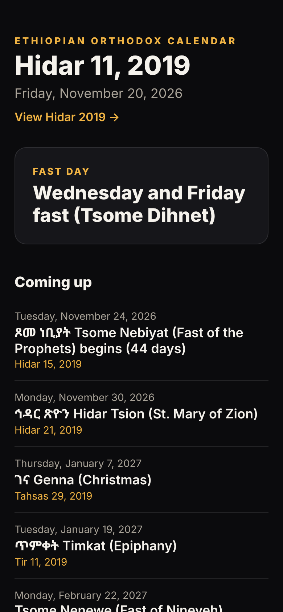
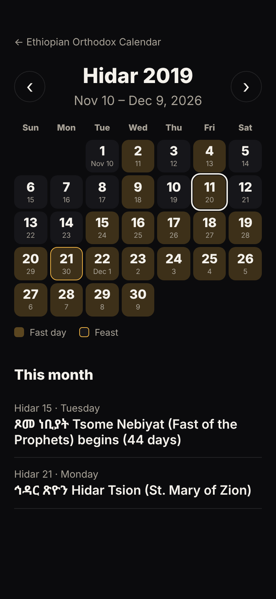
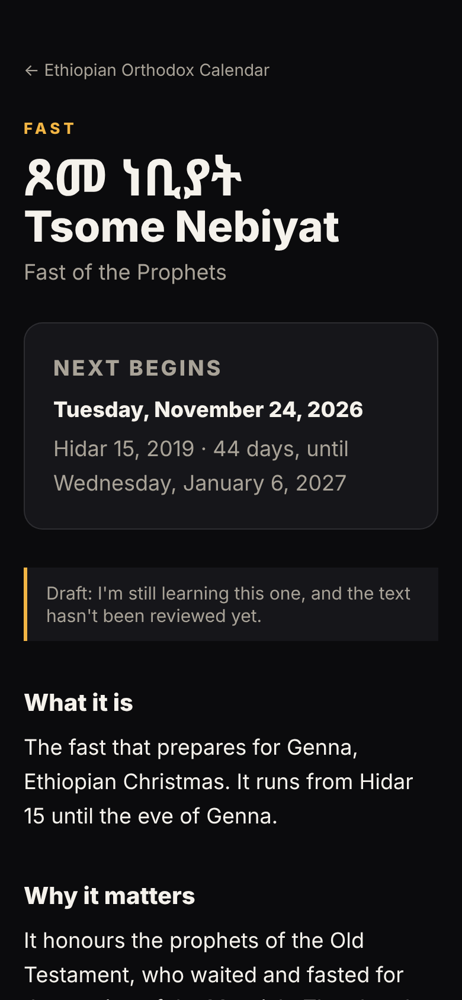
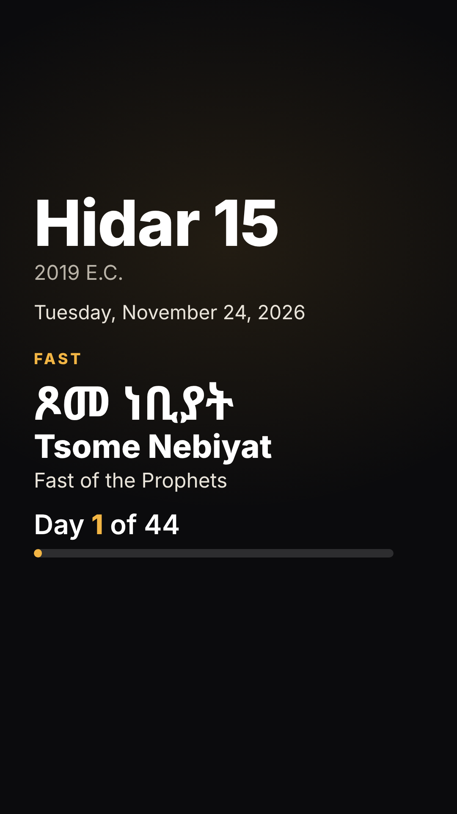

# Ethiopian Calendar Engine


**Live:** [ethiopian-calendar.onrender.com](https://ethiopian-calendar.onrender.com) · try [Tsome Nebiyat](https://ethiopian-calendar.onrender.com/tsome-nebiyat) or [Record Mode](https://ethiopian-calendar.onrender.com/record/2026-11-24)

<p>
  
  
  
  
</p>

A C# / .NET 10 engine, REST API and React + TypeScript site that converts between the Ethiopian and Gregorian calendars and computes the feasts and fasts of the Ethiopian Orthodox Tewahedo Church using **Bahire Hasab**, the church's traditional calculation.

I built it because the fasting calendar shapes my year, and most apps either skip the Ethiopian calendar or hard-code a few years of dates. This computes any year from the rules themselves.

## What it does

- Converts any date between the Ethiopian and Gregorian calendars, including Pagume and its leap day
- Computes Bahire Hasab step by step (Amete Alem → Wenber → Metqi → Tewsak → Nineveh) and exposes every intermediate value, so the result can be explained rather than just shown
- Derives all moveable observances from Nineveh: Abiy Tsom, Hosanna, Siklet, Fasika, Erget, Paraclete, Tsome Hawaryat and more
- Answers "is this a fast day, and why?" for any date: named fasts, the weekly Wednesday and Friday fasts, and their exceptions

## The site and Record Mode

The React + TypeScript site (in `web/`) shows today's Ethiopian date, whether it's a fast day ("Day 1 of 44"), and what's coming up. A month view (`/month`) shows each Ethiopian month as a grid, with Gregorian dates, fast days and feasts. Each fast and feast has its own page (`/tsome-nebiyat`, `/genna`) with when it next happens and what it means. That's where the videos send viewers.

**Record Mode** (`/record/2026-11-24`) is a fixed 1080×1920 (9:16) canvas built for screen-recording short vertical videos about each fast and feast:

- Content stays inside the safe zones that platform UI covers on Shorts, TikTok and Reels (press `G` to show them)
- Each narration beat is revealed with `→` / `Space`; `←` goes back, `R` restarts
- Large, high-contrast type that survives compression and muted, small-screen viewing
- Written content per observance (Ge'ez name, transliteration, meaning, practices, sources, review status) lives in `web/src/content/*.json`, separate from the date engine

## API

| Endpoint | Returns |
|---|---|
| `GET /api/days/{yyyy-MM-dd}` | The Ethiopian date, whether it's a fast day and which fast, and any feasts |
| `GET /api/years/{year}` | Every feast and fast period in an Ethiopian year |
| `GET /api/months/{year}/{month}` | Every day of an Ethiopian month, with its fasts and feasts |
| `GET /api/years/{year}/bahire-hasab` | The Bahire Hasab working for a year, step by step |
| `GET /api/observances/{id}/next?from={yyyy-MM-dd}` | The current or next occurrence of one fast or feast, with "Day X of Y" if it's in progress |
| `GET /api/convert/to-ethiopian/{yyyy-MM-dd}` | Gregorian → Ethiopian |
| `GET /calendar.ics` | iCalendar feed of every fast and feast for three years, including every Wednesday and Friday fast, for Google, Apple and Outlook calendars |
| `GET /api/convert/to-gregorian/{year}/{month}/{day}` | Ethiopian → Gregorian |

Invalid input (for example Pagume 6 in a non-leap year) returns `400 Bad Request` with a readable problem-details message, never a server error.

## How I know it's correct

- **Round trip:** every day from 1900 to 2100 (about 73,000 dates) converts to Ethiopian and back unchanged.
- **Two independent algorithms:** Fasika from Bahire Hasab matches the Julian Easter computus (Meeus) for every year from 1900 to 2099.
- **Published dates:** Fasika matches published dates from 2015 to 2030.
- **The Metqi = 0 edge case:** once every 19 years the Metqi value is 0 and must be read as 30. Without that rule Fasika comes out about a month late (for example in 1995). It has its own test.
- **Two independent libraries:** compared with [Kenat](https://github.com/MelakuDemeke/kenat) and [AbushakirJs](https://github.com/Nabute/AbushakirJs) for 1890–2090. Kenat agrees on every Bahire Hasab value, movable feast and conversion after 1900; every remaining difference is explained, and the comparison found three bugs in AbushakirJs. [Full results](tools/reference-check/README.md#results).
- **Calendar drift:** Genna is January 7 only from 1901 to 2100, because the Julian and Gregorian calendars drift apart at century years. The tests cover both edges.
- **Fasting rules confirmed against practice:** no fasting on Wednesdays and Fridays in the 50 days after Fasika, and none when Genna or Timkat falls on those days.
- **API integration tests** call the real endpoints over HTTP, including invalid input.
- **Calendar feed:** follows RFC 5545 (CRLF line endings, lines folded at 75 bytes without splitting multi-byte Ge'ez characters, escaped text), and was checked with an independent iCalendar parser. Event UIDs are stable, so subscribed calendars update instead of duplicating events.

## Run it

```bash
# API on :5199
dotnet run --project EthiopianCalendar.Api --urls http://localhost:5199

# Site with hot reload on :5173 (forwards /api to the API)
cd web && npm install && npm run dev
```

Tests: `dotnet test` and `cd web && npm test`.

Production is a single Docker image: the site is built into the API's `wwwroot`, so one container serves both.

```bash
docker build -t ethiopian-calendar . && docker run -p 8080:8080 ethiopian-calendar
```

Requires the .NET 10 SDK and Node 22.

## Design

- `EthiopianDate` is an immutable value type that validates in its constructor, so an invalid date can't exist.
- All conversion goes through the Julian Day Number, which turns date arithmetic across months and years into integer addition.
- Moveable observances are a data table of offsets from Nineveh, not separate functions. Adding one is a one-line change.
- The API is a thin layer over the core library. Validation lives once, in the core, and the API translates it into HTTP responses.
- Dates come from the engine; words come from content files. Each can change without touching the other.
- Record Mode's scene and step logic is a pure TypeScript module with unit tests, separate from the React components that draw it.
- Fast and feast pages get link previews (title, description, Open Graph tags) written into the HTML by the server, because WhatsApp, iMessage and search engines don't run JavaScript. Every value is HTML-encoded before it goes into the page.

## Roadmap

- [x] Ethiopian ↔ Gregorian conversion
- [x] Bahire Hasab and moveable observances
- [x] Fixed feasts and fasts, with weekly fast exceptions
- [x] REST API
- [x] Web UI with Record Mode for vertical video
- [x] Deployed publicly (Docker on Render)
- [ ] Content for every fast and feast, reviewed by a priest
- [x] Shareable page per fast and feast
- [x] iCal subscription feed
